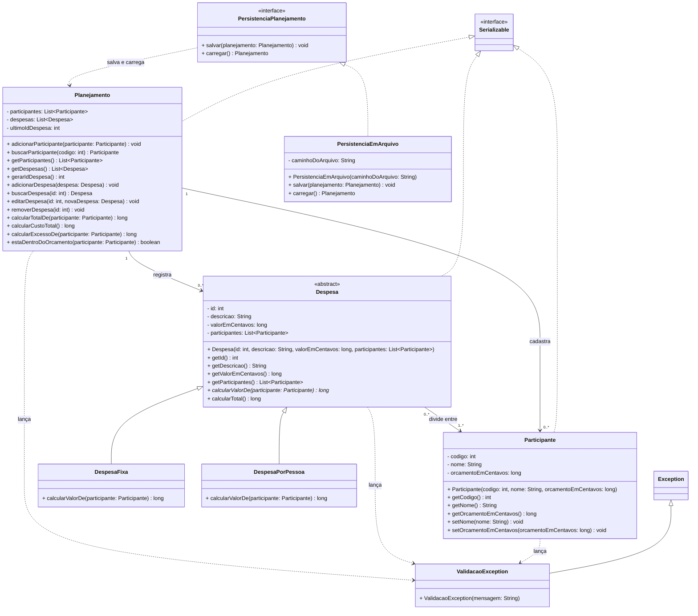

# Diagrama de classes v1

## Observações
* Utilizamos o Mermaid para que os diagramas de classe possam ser vistos em tempo real e versionados junto com o projeto
* Linhas com `-` indicam que é `private`
* Linhas com `+` indicam que é `public`

## Diagrama 

## Decisões

### Planejamento
* Criamos editarDespesa em vez de setters na Despesa: a edição cria uma despesa nova, com o mesmo ID, que substitui a anterior. Assim é possível trocar o tipo (Fixa <-> Por pessoa), o que um setter não faria, e a despesa anterior só é substituída se a nova for válida.
* Não utilizaremos ainda um método para excluir participante pois não é obrigatório (podemos criar ao final, se tivermos tempo suficiente). Se for criado, deve impedir a exclusão enquanto o participante estiver em alguma despesa.
* Criamos uma validação para evitar que haja duplicação de ID nas despesas pois o CRUD opera por ID e precisamos garantir a manipulação da Despesa exata.
* Os totais, o custo do grupo e o excesso não são guardados em atributos: são calculados na hora em que são pedidos. Assim, depois de editar ou remover uma despesa, os valores já saem atualizados (regra 5), sem precisar de código de recálculo.
* O id da despesa é gerado pelo próprio Planejamento (gerarIdDespesa), com um contador que só cresce. Assim quem cria a despesa não precisa inventar um número, e um id nunca se repete, nem depois de excluir uma despesa. Como o contador é atributo do Planejamento, ele é salvo junto no arquivo.
* Lembrete de validação/teste: Uma despesa só entra (ou substitui outra) se todos os participantes dela estiverem cadastrados no planejamento. A conferência fica no modelo, e não só na tela, para que nenhuma entrada (tela, testes ou Validador) passe por fora da regra.
* Lembrete de validação/teste: Se uma despesa for recusada depois de o id já ter sido gerado, aquele número é descartado e o próximo pula (ex.: de 3 para 5). Aceitamos esse "pulo" porque os ids continuam únicos e nenhum cálculo depende de eles serem seguidos.

### Participante
* O orçamento é guardado em centavos, como `long`: evita possíveis erros de arredondamento do double
* `Participante` não tem `setCodigo` pois ele é o ID que é definido na criação do participante e nunca muda
* Os atributos são `private` e só podem ser acessados pelos getters e setters

### Despesa
* A despesa é abstrata pois toda despesa é Fixa ou PorPessoa; uma despesa ‘pura’ não saberia calcular quanto cada participante paga, então ela não pode ser criada (não dá para usar new Despesa).
* calcularValorDe() é abstrato pois será tratado com suas regras específicas de cálculo dentro do DespesaFixa ou do DespesaPorPessoa
* calcularTotal() não é abstrato pois ele soma o calcularValorDe de cada participante, e isso é igual para os dois tipos
* valorEmCentavos na Despesa Fixa é o total da conta, na Despesa Por Pessoa o valor de cada um.
* A DespesaFixa calcula o resto da divisão exata entre os participantes e distribui os centavos que sobram, 1 centavo para cada, em ordem crescente de código, até acabarem (regra 3).”

### Persistência
* Usamos uma interface para a persistência: o resto do sistema só conhece salvar e carregar, então podemos trocar o arquivo por outra forma de gravação (ex.: banco de dados) sem mudar o controle nem a tela.
* A ligação com o Planejamento é tracejada (dependência) porque a persistência só usa o Planejamento de passagem, como parâmetro do salvar e retorno do carregar, e não o guarda como atributo. Se guardasse, seria uma associação (linha cheia).
* Gravamos o Planejamento inteiro com um único writeObject, porque a serialização é recursiva e leva junto as informações definidas do planejamento, as despesas e os participantes. Por isso, o Planejamento, o Participante e a Despesa têm o carimbo Serializable. As filhas herdam o carimbo da mãe.
* O salvar e o carregar não tratam os erros técnicos de leitura/gravação (IOException e ClassNotFoundException, ex.: arquivo inexistente, sem permissão ou corrompido): eles os repassam com throws, e quem chamou (hoje o Main, depois a tela) decide o que mostrar ao usuário. Assim esses erros ficam separados dos erros de regra de negócio (ValidacaoException).
* O arquivo `planejamento.dat` foi adicionado ao `.gitignore` pois pode mudar de acordo com o uso da execução, não é código do projeto e, em uso real, guardaria dados pessoais dos participantes.

### ValidacaoException
* Criamos uma exceção própria para separar os erros de regra de negócio (dados inválidos digitados pelo usuário) dos erros técnicos do Java (ex.: falha ao gravar o arquivo), permitindo tratar cada um de forma diferente. 
* As validações ficam antes dos this., no construtor e nos setters: assim nenhum dado inválido entra no objeto, nem na criação nem na atualização, e, se a validação recusar, os valores anteriores continuam iguais.
* Lembrete de validação/teste: Recusar sem alterar o estado, em toda operação que muda algo, todas as conferências vêm antes da primeira linha que altera dados. Nos construtores e setters, essa linha é o primeiro this.; no Planejamento, é o add (adicionar), o remove (remover) ou o set (editar). Se qualquer conferência recusar, nada foi mudado.
* Lembrete de validação/teste: As mensagens dizem o que aconteceu e com qual valor (ex.: "Já existe um participante com o código 1."), para que a pessoa saiba exatamente o que corrigir.