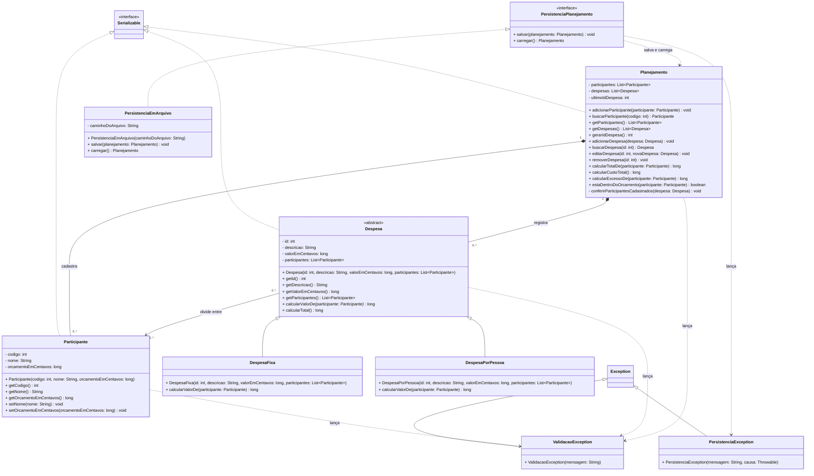

# Diagrama de classes v2

## Observações
* Utilizamos o Mermaid para que os diagramas de classe possam ser vistos em tempo real e versionados junto com o projeto
* Linhas com `-` indicam que é `private`
* Linhas com `+` indicam que é `public`

## Diagrama 

## Justificativa das relações

### Composições e associações
* `Planejamento *-- Participante` (composição, `1` para `0..*`): os participantes só existem dentro do planejamento: são cadastrados nele, guardados na sua lista privada, salvos e carregados junto com ele e descartados quando um novo planejamento começa. Pode haver planejamento ainda sem participantes (`0..*`).
* `Planejamento *-- Despesa` (composição, `1` para `0..*`): mesma lógica: a despesa nasce ao ser registrada no planejamento e deixa de existir quando é removida dele.
* `Despesa --> Participante` (associação, `0..*` para `1..*`): a despesa só aponta para quem divide o valor; ela não é dona dos participantes (apagar uma despesa não apaga ninguém). Toda despesa tem pelo menos um participante (`1..*`), e um participante pode estar em nenhuma ou em várias despesas (`0..*`).

### Heranças
* `Despesa <|-- DespesaFixa` e `DespesaPorPessoa`: as duas "são uma" Despesa: herdam id, descrição, valor, participantes e as validações, e cada uma só redefine a regra de cálculo (calcularValorDe), o que permite o polimorfismo.
* `Exception <|-- ValidacaoException` e `PersistenciaException`: exceções próprias do domínio, que herdam de Exception o comportamento de qualquer exceção (mensagem, causa) e separam erros de regra de negócio de erros de arquivo.

### Implementações (realização)
* `PersistenciaPlanejamento <|.. PersistenciaEmArquivo`: a classe de arquivo cumpre o contrato (salvar e carregar). O resto do sistema conhece só a interface, então a forma de gravar pode mudar sem afetar o restante.
* `Serializable <|.. Planejamento`, `Participante` e `Despesa`: o "carimbo" que autoriza o Java a gravar esses objetos em arquivo (as filhas da Despesa herdam o carimbo).

### Dependências
* `PersistenciaPlanejamento ..> Planejamento`: a persistência usa o planejamento só de passagem (parâmetro do salvar, retorno do carregar), sem guardá-lo como atributo.
* `Participante`, `Despesa` e `Planejamento ..> ValidacaoException`: lançam a exceção quando recusam uma entrada inválida, mas não a guardam.
* `PersistenciaPlanejamento ..> PersistenciaException`: o salvar e o carregar lançam a exceção quando o arquivo falha.

## Justificativa das coleções
* Planejamento.participantes: List (ArrayList): mantém a ordem de cadastro, que é a ordem em que a tela vai listar. Não usamos Set porque a regra de unicidade é pelo código (não pelo objeto inteiro) e precisa recusar com mensagem, o que o porteiro do adicionarParticipante faz. Não usamos Map (código → participante) porque o grupo é pequeno e a busca percorrendo a lista é simples e suficiente.
* Planejamento.despesas: List (ArrayList): mantém a ordem de lançamento e permite trocar uma despesa no mesmo lugar ao editar (indexOf + set). O id único é garantido pelo contador e pelo porteiro do adicionarDespesa.
* Despesa.participantes: List: guarda quem divide a despesa. Não usamos Set para que um participante repetido seja recusado com mensagem, em vez de sumir em silêncio, e para que a ordem informada seja mantida.

## Decisões

### Planejamento
* Criamos editarDespesa em vez de setters na Despesa: a edição cria uma despesa nova, com o mesmo ID, que substitui a anterior. Assim é possível trocar o tipo (Fixa <-> Por pessoa), o que um setter não faria, e a despesa anterior só é substituída se a nova for válida.
* Não utilizaremos ainda um método para excluir participante pois não é obrigatório (podemos criar ao final, se tivermos tempo suficiente). Se for criado, deve impedir a exclusão enquanto o participante estiver em alguma despesa.
* Criamos uma validação para evitar que haja duplicação de ID nas despesas pois o CRUD opera por ID e precisamos garantir a manipulação da Despesa exata.
* Os totais, o custo do grupo e o excesso não são guardados em atributos: são calculados na hora em que são pedidos. Assim, depois de editar ou remover uma despesa, os valores já saem atualizados (regra 5), sem precisar de código de recálculo.
* O id da despesa é gerado pelo próprio Planejamento (gerarIdDespesa), com um contador que só cresce. Assim quem cria a despesa não precisa inventar um número, e um id nunca se repete, nem depois de excluir uma despesa. Como o contador é atributo do Planejamento, ele é salvo junto no arquivo.
* Lembrete de validação/teste: Uma despesa só entra (ou substitui outra) se todos os participantes dela estiverem cadastrados no planejamento. A conferência fica no modelo, e não só na tela, para que nenhuma entrada (tela, testes ou Validador) passe por fora da regra.
* Lembrete de validação/teste: Se uma despesa for recusada depois de o id já ter sido gerado, aquele número é descartado e o próximo pula (ex.: de 3 para 5). Aceitamos esse "pulo" porque os ids continuam únicos e nenhum cálculo depende de eles serem seguidos.

### Participante
* O orçamento é guardado em centavos, como `long`: evita possíveis erros de arredondamento do double
* `Participante` não tem `setCodigo` pois ele é o ID que é definido na criação do participante e nunca muda
* Os atributos são `private` e só podem ser acessados pelos getters e setters

### Despesa
* A despesa é abstrata pois toda despesa é Fixa ou PorPessoa; uma despesa ‘pura’ não saberia calcular quanto cada participante paga, então ela não pode ser criada (não dá para usar new Despesa).
* calcularValorDe() é abstrato pois será tratado com suas regras específicas de cálculo dentro do DespesaFixa ou do DespesaPorPessoa
* calcularTotal() não é abstrato pois ele soma o calcularValorDe de cada participante, e isso é igual para os dois tipos
* valorEmCentavos na Despesa Fixa é o total da conta, na Despesa Por Pessoa o valor de cada um.
* A DespesaFixa calcula o resto da divisão exata entre os participantes e distribui os centavos que sobram, 1 centavo para cada, em ordem crescente de código, até acabarem (regra 3).”

### Persistência
* Usamos uma interface para a persistência: o resto do sistema só conhece salvar e carregar, então podemos trocar o arquivo por outra forma de gravação (ex.: banco de dados) sem mudar o controle nem a tela.
* A ligação com o Planejamento é tracejada (dependência) porque a persistência só usa o Planejamento de passagem, como parâmetro do salvar e retorno do carregar, e não o guarda como atributo. Se guardasse, seria uma associação (linha cheia).
* Gravamos o Planejamento inteiro com um único writeObject, porque a serialização é recursiva e leva junto as informações definidas do planejamento, as despesas e os participantes. Por isso, o Planejamento, o Participante e a Despesa têm o carimbo Serializable. As filhas herdam o carimbo da mãe.
* O salvar e o carregar capturam os erros técnicos de leitura/gravação (IOException, ClassNotFoundException e ClassCastException, ex: arquivo inexistente/vazio/cortado/de texto/com outro tipo de objeto) e os embrulham numa exceção nossa, a PersistenciaException, com uma mensagem clara e o erro original guardado como causa. Quem usar a persistência (Main e/ou Front) trata um único tipo de erro, separado dos erros de regra de negócio (ValidacaoException).
* O arquivo `planejamento.dat` foi adicionado ao `.gitignore` pois pode mudar de acordo com o uso da execução, não é código do projeto e, em uso real, guardaria dados pessoais dos participantes.
* Todas as classes gravadas têm serialVersionUID = 1L fixo: sem ele, o Java calcula um número a partir do código, e qualquer mudança na classe impediria abrir arquivos salvos antes.
* Ao carregar, o planejamento novo é lido para uma variável à parte e só depois substitui o que está em uso. Se o arquivo for inválido, a exceção acontece antes da troca e o planejamento em uso continua igual.

### ValidacaoException
* Criamos uma exceção própria para separar os erros de regra de negócio (dados inválidos digitados pelo usuário) dos erros técnicos do Java (ex.: falha ao gravar o arquivo), permitindo tratar cada um de forma diferente. 
* As validações ficam antes dos this., no construtor e nos setters: assim nenhum dado inválido entra no objeto, nem na criação nem na atualização, e, se a validação recusar, os valores anteriores continuam iguais.
* Lembrete de validação/teste: Recusar sem alterar o estado, em toda operação que muda algo, todas as conferências vêm antes da primeira linha que altera dados. Nos construtores e setters, essa linha é o primeiro this.; no Planejamento, é o add (adicionar), o remove (remover) ou o set (editar). Se qualquer conferência recusar, nada foi mudado.
* Lembrete de validação/teste: As mensagens dizem o que aconteceu e com qual valor (ex.: "Já existe um participante com o código 1."), para que a pessoa saiba exatamente o que corrigir.